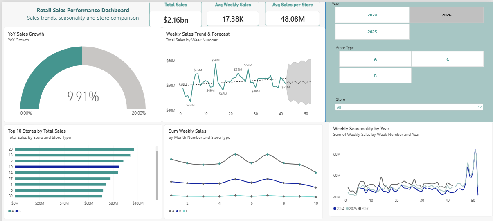
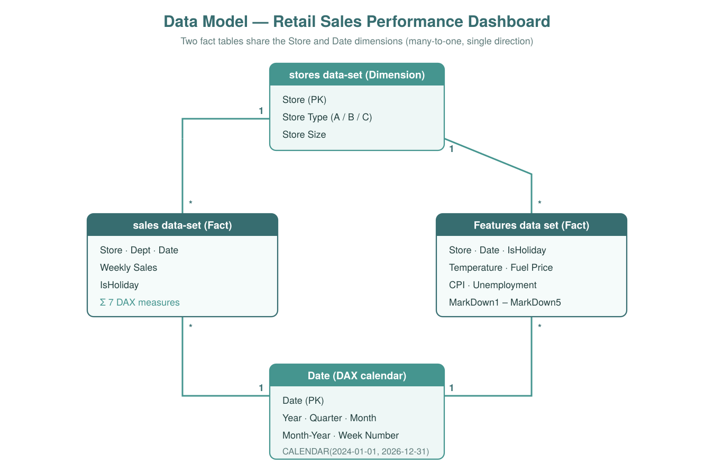

# 🛒 Retail Sales Performance Dashboard


> **Sales trends, seasonality and store comparison** for a 45-store retail chain, built in Power BI.



---

## 📌 Business Problem

Regional managers need one page that answers:

1. **How are we doing overall?** Total sales, average weekly sales, sales per store.
2. **Are we growing?** Year-over-year sales growth against target.
3. **Where is the money coming from?** Which stores and store types (A / B / C) drive revenue.
4. **When do sales peak?** Weekly seasonality and holiday effects, compared year by year.
5. **What's next?** A short-term forecast of weekly sales.

## 📂 Dataset

Based on the [Retail Data Analytics](https://www.kaggle.com/datasets/manjeetsingh/retaildataset) dataset on Kaggle: historical weekly sales for **45 stores**, broken down by department.

| File | Grain | Key columns |
|---|---|---|
| `stores data-set.csv` | 1 row per store | Store, Type (A/B/C), Size |
| `sales data-set.csv` | Store × Dept × Week | Store, Dept, Date, Weekly_Sales, IsHoliday |
| `Features data set.csv` | Store × Week | Temperature, Fuel_Price, MarkDown1–5, CPI, Unemployment, IsHoliday |

> The raw CSVs are not included in this repo. Download them from Kaggle (link above).

## 🔄 Data Preparation (Power Query)

- Imported the three CSVs and promoted headers
- Set data types (whole number, date, decimal, true/false)
- Renamed columns for readability (`Weekly_Sales` → `Weekly Sales`, `Size` → `Store Size`, `Type` → `Store Type`, `Fuel_Price` → `Fuel Price`)

Full M code: [`power-query/`](power-query/)

## 🧩 Data Model

Two fact tables (`sales`, `features`) share a **Store** dimension and a **DAX-generated Date** table, with single-direction many-to-one relationships.



## 🧮 Key DAX Measures

| Measure | What it shows |
|---|---|
| `Total Sales` | Sum of weekly sales |
| `Avg Weekly Sales` | Average weekly sales value |
| `Average Sales per Store` | Total sales ÷ number of distinct stores |
| `Sales Last Year` | Same period last year, capped at the last date with sales so partial years compare fairly |
| `YoY Growth` | (Total Sales − Sales Last Year) ÷ Sales Last Year |

```dax
Sales Last Year =
VAR LastSaleDate =
    CALCULATE ( MAX ( 'sales data-set'[Date] ), REMOVEFILTERS () )
RETURN
    CALCULATE (
        [Total Sales],
        DATEADD (
            FILTER ( VALUES ( 'Date'[Date] ), 'Date'[Date] <= LastSaleDate ),
            -1, YEAR
        )
    )
```

All measures: [`dax/measures.dax`](dax/measures.dax)

## 📊 Dashboard Features

| Visual | Purpose |
|---|---|
| **KPI cards** | Total Sales · Avg Weekly Sales · Avg Sales per Store |
| **Gauge: YoY Sales Growth** | Growth vs. a 0–20% target range |
| **Line: Weekly Sales Trend & Forecast** | Weekly trend with a trend line and a 10-week forecast (99% confidence band) |
| **Bar: Top 10 Stores by Total Sales** | Best-performing stores, colored by store type |
| **Line: Monthly Sales by Store Type** | Compares A, B and C formats across the year |
| **Line: Weekly Seasonality by Year** | Overlays years to show recurring peaks (holiday weeks) |
| **Slicers** | Year · Store Type · Store |

## 💡 Key Insights

- **Type A stores drive nearly two-thirds of revenue.** The 22 Type A stores (49% of the chain) generate **64.3%** of total sales ($4.33B of $6.74B). An average Type A store sells $196.9M, compared with $117.7M for Type B and $67.6M for Type C.
- **The top 10 stores account for 39.1% of total sales**, and 9 of them are Type A. Store 20 leads with $301.4M, which is 8.1× the lowest-selling store (Store 33, $37.2M).
- **Store size is the strongest driver of sales.** Store size and total sales have a correlation of 0.85, so bigger stores consistently sell more.
- **The week before Christmas is the biggest spike of the year, not the officially flagged holiday weeks.** The pre-Christmas week reached $81M in 2024 and $77M in 2025, about 1.7× an average week ($47M). All of the top 8 sales weeks fall between Thanksgiving and Christmas. Officially flagged holiday weeks average only 7.8% above normal weeks, because the Christmas flag falls on the quieter week after Christmas.
- **January is the weakest month**, averaging $41.6M per week. That is 28% below December ($57.7M), which points to a clear post-holiday slump.
- **YoY growth for the latest year is +5.0%.** Sales for Jan to late Oct reached $2.00B, compared with $1.90B for the same period the year before. The latest year's data ends in October, so the DAX compares the same months in both years.
- **Sales are concentrated in a few departments.** The top 5 departments (92, 95, 38, 72, 90) make up 28.5% of all sales.

**Recommendation:** Plan stock and staff around the 5 weeks from Thanksgiving to Christmas, and look at why the smaller Type A stores (e.g. Stores 33 and 36) underperform.

## 🛠️ Skills Demonstrated

`Data modeling (star schema)` · `Power Query ETL` · `DAX measures` · `Time intelligence (YoY)` · `Forecasting & trend lines` · `Interactive slicers` · `Dashboard design`

## ▶️ How to Open

1. Download [`Retail_Sales_Performance_Dashboard.pbit`](Retail_Sales_Performance_Dashboard.pbit) and the dataset from Kaggle.
2. Open the `.pbit` in **Power BI Desktop**.
3. If you see a file-path error, go to **Transform data**. For each of the 3 queries, open **Source** and point it to where you saved the CSV.
4. Click **Close & Apply**.

---

⬅️ [Back to portfolio](../README.md)
