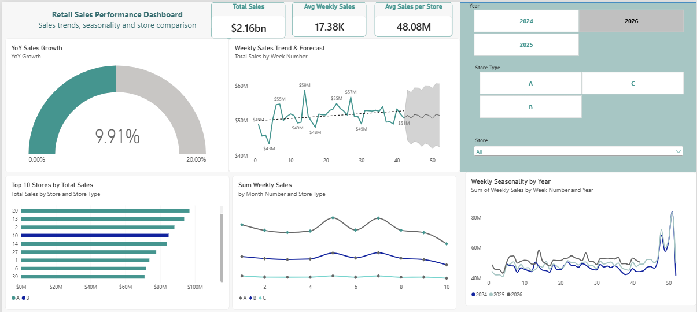

<!-- ✏️ Replace everything in [square brackets] with your own details -->

# 📊 Power BI Portfolio Projects


Welcome to my Power BI portfolio! Each project turns a raw dataset into an interactive dashboard that answers a real business question. Every project folder contains the Power BI template (`.pbit`), the DAX measures, the Power Query steps, the data model, and the key insights.

---

## 👋 About Me

I'm **Proudmorakod Tranghiranyathorn**, a third year student at Chulalongkorn University who enjoys turning messy data into clear, decision-ready dashboards. I work with Power BI (DAX, Power Query, data modeling), Excel and SQL. I focus on dashboards that are easy to read and built around the questions stakeholders actually ask.

 ✉️ proud1372548@gmail.com

---

## 🗂️ Projects

| # | Project | Domain | Highlights |
|---|---|---|---|
| 01 | [Retail Sales Performance Dashboard](01-Retail-Sales-Performance-Dashboard/) | Retail | YoY time intelligence · forecasting · seasonality |

---

## 01 · [Retail Sales Performance Dashboard](01-Retail-Sales-Performance-Dashboard/)

[](01-Retail-Sales-Performance-Dashboard/)

A single-page dashboard tracking **sales trends, seasonality and store comparison** across 45 retail stores, built on the Kaggle *Retail Data Analytics* dataset.

- **KPIs:** Total Sales, Avg Weekly Sales, Avg Sales per Store, YoY Growth gauge
- **Analysis:** Top 10 stores by store type, monthly sales by store type, weekly seasonality overlaid by year
- **Forecast:** 10-week sales forecast with trend line and confidence band
- **Techniques:** Star schema with a DAX calendar table, `DATEADD`-based Sales Last Year measure, Power Query cleaning

**Tools:** Power BI Desktop · DAX · Power Query
**📁 [View project →](01-Retail-Sales-Performance-Dashboard/)**

---

## 🧰 Repository Structure

```
PowerBI-Portfolio/
├── README.md                                  ← you are here
├── 01-Retail-Sales-Performance-Dashboard/
│   ├── README.md                              ← problem, model, DAX, insights
│   ├── Retail_Sales_Performance_Dashboard.pbit
│   ├── dax/measures.dax
│   ├── power-query/*.m
│   └── images/ (dashboard.png, data-model.png)
└── _project-template/                         ← copy this for each new project
```

---

## 📄 License

The dashboards and code in this repository are my own work and are free to view for learning purposes. Each dataset belongs to its original source, linked in the project's README.
